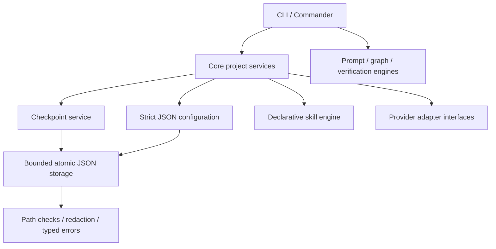
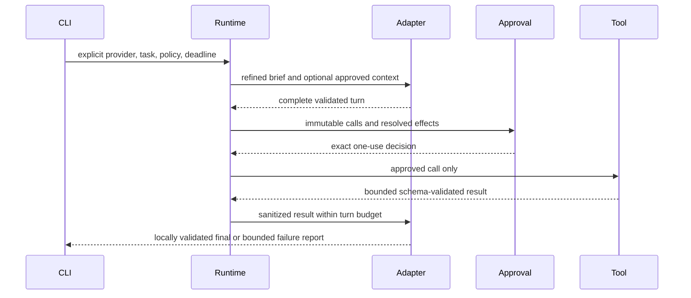

# Architecture

AgentForge separates portable instructions, deterministic engines and host interfaces. The initial implementation is one npm package with focused TypeScript modules; separate published workspace packages would add release overhead without improving these boundaries yet.

| Module          | Responsibility                                                                                            |
| --------------- | --------------------------------------------------------------------------------------------------------- |
| `src/cli/`      | Parse arguments, present reports, map failures to exit codes, propagate cancellation                      |
| `src/core/`     | Configuration, checkpoint lifecycle, project diagnostics, integration coordination                        |
| `src/engines/`  | Portable skill parsing, deterministic prompt transformations, repository graph, bounded process execution |
| `src/adapters/` | Typed capability/health contract, local adapter, optional providers, bounded transport and native codecs  |
| `src/shared/`   | Safety helpers and typed policy errors                                                                    |
| `skills/`       | Provider-neutral JSON definitions and readable SKILL.md procedures                                        |
| `schemas/`      | Versioned config, checkpoint and skill schemas                                                            |

Core imports interfaces and engines; engines do not import CLI presentation or vendor SDKs. The CLI invokes the independent engines directly for simple one-step operations. Storage does not import skill logic. No module requires a particular model or calls a model implicitly. Optional configured providers are selected per invocation, with separate network permission and approval. Their bounded HTTP transport is isolated in `src/adapters/`.

## Data flow

`init` validates defaults and atomically creates `agentforge.config.json` without clobbering an existing file. Every subsequent config load is revalidated; unknown keys fail. `config set` validates the complete proposed object before replacing the file.

`context save` stores only explicit text supplied by the caller. It redacts recognizable credentials, assigns a schema version and random id, and writes under the configured checkpoint directory inside `.agentforge/`. Restore first returns contents and effects; `--apply` writes a separate active-context document. It never mutates code or configuration.

`skill list/inspect/validate` parses bounded JSON documents. Procedures remain inert text. Duplicates, bad capabilities and unsafe asset paths fail validation. Provider names cannot silently enable capabilities.

`verify` reads declared argument arrays and returns a preview. Only explicit approved execution spawns processes. `run` applies iteration, deadline and repeated-failure stop conditions to those checks. Actual results, not intended outcomes, determine reports.

## Boundaries and extension

[Security boundaries](docs/architecture/security-boundaries.md) describe path checks, output caps and OS limitations. Graph edges are heuristic, not semantic compiler analysis; no source contents are included in the report. No generated cache is used, so graphs reflect a fresh scan.

An adapter declares identity, kind, health and capabilities. Optional model submission has typed cancellation, timeout and usage availability. A new adapter must provide deterministic contract tests and documentation before registration. The shipped local adapter truthfully advertises no remote model, tool API or token telemetry capability. [Adapter development](docs/integrations/adapter-development.md) explains this contract.

Optional model adapters implement native non-streaming text protocols. `providers` holds model/endpoint/credential-name settings; credentials are resolved only from the selected environment variable at runtime. Offline health never makes a request. The CLI gates inference/connection checks before calling the transport, which independently requires approval, rejects redirects, and bounds time/bytes. Responses are returned as untrusted text plus explicit finish/usage status, never executable instructions. See [provider setup](docs/integrations/providers.md).

Streaming uses the same approved bounded byte transport as ordinary requests. An incremental framing layer parses SSE/NDJSON; provider codecs enforce native lifecycle/usage; a shared finalizer sanitizes text and validates structured terminals. The schema is snapshotted before the request and passed through native format fields. Ajv validates a bounded portable subset without remote references or data mutation. `--stream` presents JSON Lines and `--schema` reads an explicitly named safe project-relative file.

Client tool sessions keep native history inside adapters and expose provider-neutral function calls/results. The shared session validates declarations, arguments, result IDs, turn budgets and response states; each `next` requires network approval and never executes a tool. The separate tool engine resolves host-owned handlers and review details into an immutable batch with a one-use approval ID. The CLI displays the batch and requires exact terminal approval plus tool permission; the configured-check tool also requires process permission. Only approved, sanitized tool results return to the selected provider. See [tool contract](docs/integrations/tool-invocation.md).

Tool codecs optionally stream private native events (text deltas and a reconstructed terminal response). The shared session reuses line-aware text sanitization, waits for clean EOF, validates the terminal with the same call/schema checks as ordinary turns, then commits continuation state. It exposes no partial executable arguments. The conversation engine consumes the complete stream before the existing approval/execution boundary; `--stream` affects transport and presentation without granting permissions.

Combined tool/output sessions snapshot an optional final-response schema at construction. The session passes fresh copies through `ToolRequestOptions` to native codecs, which send schema fields alongside tool definitions. Intermediate tool turns remain pending; completed answers pass through the same raw validation, data redaction and revalidation as structured prompts. Schema-mode streams withhold all text and deliver the validated terminal object without a second string-redaction pass. Execution stays in the independent exact-approval engine.

Tool definitions may also carry a local `resultSchema`. The common layer strips it before supplying declarations to native codecs. The approval engine snapshots it with the resolved review and includes it in the batch ID. Successful host values pass raw JSON validation, data redaction and revalidation; the session independently repeats the check with the selected credential before native continuation. Result schemas allow any JSON root within the bounded subset, while argument and final-answer roots stay objects. Executor validation failures stop later handlers; session validation failures withhold the follow-up after the batch. Handler exceptions remain normalized tool errors. Built-ins have default result schemas and CLI overrides are loaded before requests.

The composed `task` entry point uses `src/engines/task-runtime.ts`: explicit provider/model selection, `refinePrompt`, opt-in current checkpoint data, the shared tool conversation, per-batch approval and normalized status/usage/error reports. It adds a total deadline, cumulative tool-call/output limits and safe provisional-output retention. It does not create subagents, edit files, persist hidden conversations or select fallback providers. The existing `run` command remains a local verification loop.

Project file tools are registered by `project-file-tools.ts`; `project-files.ts` supplies bounded filesystem operations independently of provider protocols. Declaration/review perform no filesystem reads. Semantic argument checks run before approval; current filesystem/ignore/link checks run during approved execution. Native codecs receive only portable tool arguments and validated result strings. Search scope/range approval does not freeze future file contents.

Git inspection uses `git-inspection.ts` behind `git-tools.ts` and the offline `git` CLI. Root/config/metadata checks, fixed argv, sanitized environment and process/output deadlines are independent of provider codecs. The logical operations status/diff/log/branch use native-safe underscore tool names. Only explicit existing-file diffs are supported; unsafe metadata layouts and execution-capable configuration fail safely. See [Git inspection](docs/integrations/git-inspection.md).

Controlled edits use full raw snapshots from `project-files.ts`, preserving byte identity separately from the line-range read API. `project-edit.ts` validates unique replacements/strict patches and owns a bounded, expiring proposal store in each registry closure. `project-edit-tools.ts` resolves immutable exact diff reviews before approval. Apply compares current bytes/identity and consumes the proposal, but the built-in Node backend always returns conflict or unavailable without writing because atomic compare-and-replace cannot be guaranteed. This user-selected fail-closed policy is inspectable with `edit capabilities`; no simulated backend is substituted. See [edit policy](docs/integrations/project-edits.md).

`orchestration.ts` snapshots validated configuration before planning. A tool-free planner returns a strict plan; semantic validation bounds subtasks, scopes and serialized context before dispatch. Workers call the existing task runtime with trusted immutable configuration, a downward output budget and a restricted host-owned registry. No worker receives a delegation or arbitrary verification-process tool. A central approval queue serializes exact batch reviews; scope checks precede approval. Finite concurrency/depth/time/output limits, partial results and path conflict reports are host responsibilities, independent of provider protocols. Structured worker completion is a validated claim, not evidence of successful implementation. See [orchestration contracts](docs/features/orchestration.md).

## Read stability and diagnostic safety

JSON storage and skill metadata require a single-link regular file, complete bounded reads, fatal UTF-8 decoding and unchanged descriptor identity/size/timestamps. Graph reads follow the same complete-read and identity checks; unsafe or changing sources make the graph explicitly truncated. Source and ignore-policy hard links are rejected. JSON replacement cleans its temporary file after failed writes or syncs and preserves the old target. Atomic replacement is distinct from atomic version-checked source application, which remains unavailable; parent-directory crash durability is not guaranteed.

Provider model validation is shared by configuration and invocation overrides and rejects terminal controls before whitespace normalization. Adapters redact their selected credential, including custom environment references; runtime/CLI reports additionally collect only explicitly configured credential references. Sensitive JSON property names or typed primitive leaves cannot safely be renamed/coerced, so those payloads are withheld. Native usage counters remain numeric telemetry.

## Lifecycle and extension points

`src/cli/index.ts` loads package metadata, builds Commander commands, handles signals and emits normalized errors. Typed errors map policy, validation, unavailable, cancellation and execution failures to documented exit codes. Deadlines cover transport, worker scheduling and approval waits; cancelled or expired operations cannot gain new authority. Native continuation state stays behind adapters.

To add a provider, implement the typed contract in `src/adapters/types.ts`, add explicit registration/configuration and native-protocol loopback tests; use the common transport, schema and approval boundaries. See [adapter development](docs/integrations/adapter-development.md). To add a skill, supply bounded `skill.json` metadata and a readable `SKILL.md`, then run validation; no engine or provider change is required. See [skill authoring](docs/skills/authoring-guide.md).

## Testing, packaging and release

Real temporary files/repositories/processes and loopback HTTP fixtures exercise boundary behavior. Installed-package smoke checks verify bundled assets and credential-free commands; POSIX pseudo-terminal checks verify actual approval, denial and Ctrl+C. [Testing](docs/development/testing.md) distinguishes local evidence from prepared CI coverage.

TypeScript builds into `dist/` with declarations and relative source maps. This private CLI package exposes a bin entry and no supported public library export. The explicit package file allowlist carries runtime assets, skills, source, schemas, examples and documentation. Tests, local state and reports stay outside the archive. The [release checklist](docs/development/release-process.md) requires verification and separate owner approval; the manual workflow uploads a development artifact only.

Regular-file descriptor opens use nonblocking/no-follow flags before `fstat`, so a FIFO cannot hang before type rejection on POSIX. The generated config schema also encodes the model control-character restriction; runtime validation remains authoritative for semantic checks such as endpoint policy.
