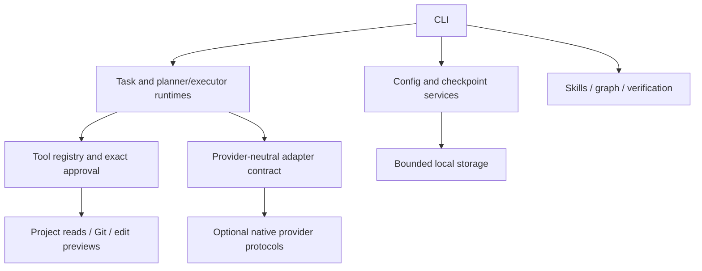

# AgentForge

A provider-neutral, local-first developer toolkit with a TypeScript CLI, bounded AI workflows and 13 portable skills. This checkout is an **unpublished development version**. Local diagnostics and skill commands need no API credentials. Optional inference requires an explicitly configured provider and network approval.

## What works

- Strict configuration, explicit context checkpoints and bounded local storage.
- Prompt refinement, conservative compaction and clearly labeled token estimates.
- Ignore-aware project search, file listing, line-range reads and heuristic import graphs.
- Approved verification processes and finite verification loops.
- Ordinary and streaming model conversations, locally validated structured answers and tool results.
- Exact, one-use terminal approval for tool batches, read-only Git inspection and complete edit previews.
- Optional planner/executor conversations with scoped tools, central approval and at most two workers.

File application **fails closed** on the current Node backend: stale files report conflict; unchanged files report unavailable before any write. Skills are declarative procedures for a human or compatible agent. Loading them does not execute code.

## Requirements and installation

Requires Node.js **22.13+ in the 22.x line, or 24+**, and npm. The actual local checks run on macOS with Node 24. Prepared CI covers Linux Node 22/24, macOS Node 24 and a narrower Windows installation smoke check; hosted CI has not been run from this checkout. POSIX terminal tests additionally need Python 3 and Git.

```sh
npm ci
npm run build
node dist/cli/index.js --help
node dist/cli/index.js --version
```

Use `npm run dev -- <command>` during development. In examples below, `agentforge` means an installed CLI; substitute `node dist/cli/index.js` from this checkout. To test a local installation:

```sh
mkdir -p work/package
npm pack --pack-destination work/package
# Install the exact tarball printed above into an isolated prefix:
npm install --prefix work/install --ignore-scripts --omit=dev work/package/agentforge-local-toolkit-0.1.0-dev.0.tgz
node work/install/node_modules/agentforge-local-toolkit/dist/cli/index.js --help
```

Installing the local tarball may contact the npm registry for dependencies; it does not contact an AI provider. The automated smoke suites use a lock-derived offline installer instead of assuming registry metadata is cached.

There is no public package installation command or published version. Package metadata is private. The archive includes compiled JavaScript/declarations, portable skills, schemas, source, examples and documentation; local state, tests, historical plans, dependencies and reports are excluded. This is a CLI package with no supported library exports.

## Start offline

```sh
agentforge init
agentforge doctor
agentforge status
agentforge config
agentforge provider list
agentforge tools list
agentforge skill list
agentforge skill validate
agentforge prompt --task "Add a parser; preserve existing behavior"
agentforge graph
agentforge verify
```

`init` preserves an existing valid configuration. `verify` previews commands. Add `--cwd <directory>` to inspect another existing project. Use `--json` for machine-readable reports. See the [command reference](docs/cli/commands.md).

## Providers and explicit setup

| Provider  | Implemented capabilities                                                       | Credential                                               |
| --------- | ------------------------------------------------------------------------------ | -------------------------------------------------------- |
| Local     | Offline diagnostics and deterministic engines; no inference                    | None                                                     |
| OpenAI    | Responses text/SSE, structured finals, client tool conversations, native usage | `OPENAI_API_KEY`                                         |
| Anthropic | Messages text/SSE, structured finals, client tool conversations, native usage  | `ANTHROPIC_API_KEY`                                      |
| Ollama    | Chat text/NDJSON, structured finals, client tool conversations, native usage   | None by default; optional explicit environment reference |

Adapters have native-protocol loopback tests. Live accounts, upstream model availability and real Ollama inference have not been tested. The engine has no preferred vendor or automatic fallback.

Choose a real model available to you. **`YOUR_MODEL_ID` is a placeholder.** Setting `providers` replaces the entire array, so preserve other entries you need.

```sh
agentforge config set providers '[{"id":"openai","model":"YOUR_MODEL_ID","maxOutputTokens":1024}]'
agentforge provider check openai
agentforge config set permissions.allowNetwork true
agentforge prompt --model --provider openai --task "Explain this explicit requirement" --approve-network
```

Supply the credential through trusted environment/secret-management tooling; never put its value in config or command arguments. For Anthropic use `id: anthropic`; for Ollama use `id: ollama` and a preinstalled model. An explicit `apiKeyEnv` references a variable ending in `_KEY` or `_TOKEN`; it never stores the key. Custom endpoints receive the configured authentication header when approved. See [provider setup and endpoint policy](docs/integrations/providers.md).

## Tools, streaming and structured answers

```sh
agentforge config set permissions.allowTools true
agentforge tools run --provider openai --task "Find and explain the parser" --approve-network --execute
agentforge tools run --provider openai --task "Return a JSON answer about the parser" --approve-network --execute --stream --schema examples/answer.schema.json
```

Use the schema path only in a project containing that file. The fixed `project_search` tool supports literal path/content searches and bounded file listing; `project_read` accepts explicit line ranges. Both validate arguments/results and enforce ignore, path, link, UTF-8 and size policy. [Project file tools](docs/integrations/project-files.md) explains the contract.

Each complete tool batch displays its exact actions and resolved effects. Execution requires the configuration permission, `--execute`, and typing `approve <displayed-batch-id>` at a real terminal. Piped input, model text, denial, cancellation and late approval grant no authority. Every new batch needs fresh approval. Git and configured verification tools also require process permission.

`--stream` emits JSON Lines. Text deltas are provisional; structured streams withhold text until the final object validates locally. Tool arguments remain private until the complete turn passes validation. Built-in result schemas validate values before continuation; `--result-schemas <relative-file>` supplies explicit overrides. See [tool invocation](docs/integrations/tool-invocation.md) and [streaming/schema behavior](docs/integrations/streaming-structured.md).

## Bounded tasks and checkpoints

```sh
agentforge context save --name parser --objective "Explain parser" --summary "Review tests first"
agentforge context list
agentforge task --provider openai --model YOUR_MODEL_ID --task "Explain the parser" --approve-network --execute --with-context --stream
```

Use a returned checkpoint ID with `context restore <id>` to preview it; `context restore <id> --apply` updates only `.agentforge/context.json`. Source and configuration are never restored. `--with-context` explicitly sends current context as untrusted reference data; it is omitted by default.

`task` refines the task and runs finite provider/tool turns with call, output and total deadline limits. It reports native usage and bounded safe partial output on failure. It never selects a provider or grants tool permission automatically. See [runtime lifecycle](docs/features/task-runtime.md) and [checkpoint behavior](docs/features/context-management.md).

## Git, edits and verification

```sh
agentforge git status
agentforge git diff --path README.md
agentforge git log --limit 5
agentforge edit capabilities
agentforge edit replace --path README.md --old "existing unique text" --new "replacement text"
agentforge verify
```

These commands preview operations. Approved Git inspection and edit previews require process/tool policy as applicable, `--execute`, and exact terminal approval. Edit previews read the existing file and generate a complete bounded diff; apply needs separate approval but remains unavailable on the current backend. See [Git boundaries](docs/integrations/git-inspection.md) and [edit guarantees](docs/integrations/project-edits.md).

Verification uses configured executable/argument arrays. To run a harmless check:

```sh
agentforge config set verification.checks '[{"name":"node-version","command":"node","args":["--version"]}]'
agentforge config set permissions.allowProcess true
agentforge verify --execute --approve
agentforge run --execute --approve
```

`run` reruns approved checks within iteration/time/repeated-failure limits and makes no edits. Approved programs have OS user privileges; only configure trusted checks.

## Optional planner/executor orchestration

```sh
agentforge orchestrate status
agentforge config set orchestration.planner '{"provider":"openai"}'
agentforge config set orchestration.executor '{"provider":"openai"}'
agentforge config set orchestration.enabled true
agentforge orchestrate plan --task "Plan a parser review" --approve-network
agentforge orchestrate run --task "Review the parser" --approve-network --execute
```

These examples require the provider/network/tool setup above. Roles may reference different configured providers/models. Scheduling defaults disabled, allows at most two workers, and enforces depth, task, context, output and deadline limits. Workers inherit scoped permissions and centrally approved tools; they cannot delegate or apply edits. Conflicts and partial failures are reported. `--no-subagents` prevents worker dispatch. This is built-in conversation scheduling; no external coding-host integration is claimed. See [orchestration contracts](docs/features/orchestration.md).

## Architecture and skills



[ARCHITECTURE.md](ARCHITECTURE.md) maps modules, data flow, extension points and tests. Engines remain independent of terminal presentation and vendor protocols. Private `.agentforge/` state stays inside the selected project root and is ignored by Git.

All 13 bundled skills are preserved: **AgentFlow, ContextPilot, DebugSherlock, Graphify, PromptForge, PromptLoop, SecureShip, ShipNotes, SkillForge, SmartDiff, TokenSaver, UIUX Architect and VerifyLoop**. See the [skill catalog](SKILLS.md) for purposes and requirements. Inspect one using `agentforge skill inspect verifyloop`; follow the [authoring guide](docs/skills/authoring-guide.md) to add a declarative skill.

## Security and known limitations

Permissions and approvals fail closed. Schemas validate raw and sanitized structured values without coercion. Configured credentials are redacted from diagnostic metadata; model IDs reject terminal control characters. JSON/skill/source/policy reads reject unsafe links and use bounded reads. These checks and secret redaction are safeguards, not an OS sandbox or complete secret detector.

Use a trusted workspace: portable path checks cannot exclude hostile concurrent ancestor replacement. Approved subprocesses retain user privileges; detached descendants and Windows process trees have containment limits. Cancellation cannot guarantee a remote job stopped or billing ceased. Graphs are heuristic, usage may be unavailable, worker completion remains a model claim, and conflict-safe file application is unavailable. See [SECURITY.md](SECURITY.md) for precise boundaries.

## Development, checks and release preparation

```sh
npm run check
npm audit
npm run test:packed
npm run test:terminal
```

`check` runs formatting, lint, strict types, unit/integration tests, production build, skill/schema validation and local documentation-link validation. Packed tests install into temporary directories; terminal tests exercise real approval, denial and Ctrl+C against loopback providers. No live credentials are needed. See [testing](docs/development/testing.md), [contributing](CONTRIBUTING.md) and [local release checklist](docs/development/release-process.md).

The [roadmap](ROADMAP.md) records implemented and planned work. The [Unreleased changelog](CHANGELOG.md) records this development checkout. Public release still needs verified copyright attribution, ownership, support/security routes and explicit approval. No repository, remote, release or package publication is configured.

## Support and license

Use [SUPPORT.md](SUPPORT.md) for local diagnostics and reporting guidance; no public support address or service commitment exists. [CODE_OF_CONDUCT.md](CODE_OF_CONDUCT.md) and [GOVERNANCE.md](GOVERNANCE.md) state the current community limitations honestly.

Licensed under the [MIT License](LICENSE), with collective attribution to AgentForge contributors. No individual maintainer identities, repository URLs, badges, release links or funding destinations are configured. CODEOWNERS and funding configuration remain absent until verified information exists.
